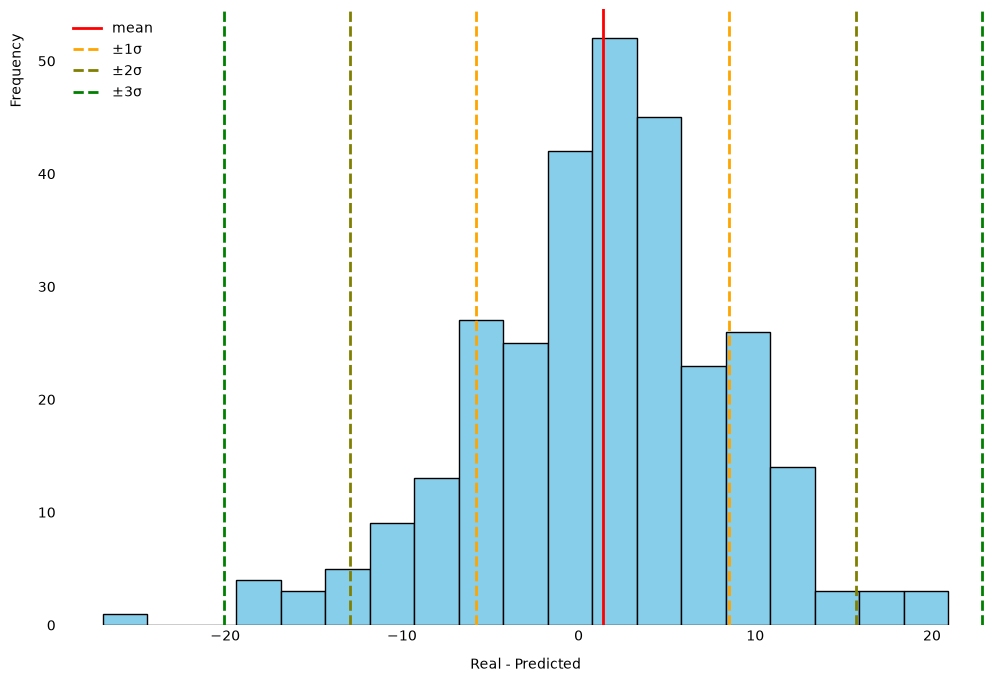

# predict anime score

A model that predicts the [AniList](https://anilist.co) mean score (0-100) of an anime
using only information that is known **before** its release. Test it [here](https://anidash.streamlit.app/predictor)

> This is my first machine learning model. It surely contains errors and things that
> could have been done better.

## What the model does

Given an anime, it estimates the mean score it will end up with on AniList.

Since the goal is to predict future anime, everything that only exists after the
release (popularity, rank, members, favorites, watching...) was excluded. The model
only uses:

- type, source, number of episodes and episode duration
- release season and year
- genres and tags
- main studios, number of studios involved and main staff
- number of streaming sites, whether it has an English title, whether it is adult

One of them is not completely clean: the number of streaming sites may increase once
the anime is released, so it might carry some post-release information.

It was trained with finished Japanese anime (excluding music videos) released before 2026.
The 2026 ones were kept apart for the final test.

The model is a scikit-learn pipeline: the preprocessing in
[`anime_transformers.py`](anime_transformers.py) followed by a
`HistGradientBoostingRegressor`. The steps are explained in [`notebooks/`](notebooks/),
in this order: `clean` → `train` → `test`.

## Final scores

Errors are in score points, on the 0-100 scale.

| Set | Entries | RMSE | MAE |
|---|---|---|---|
| Validation (random 20% of the pre-2026 anime) | 2,721 | 6.95 | 5.24 |
| Test (2026 anime) | 298 | 7.28 | 5.64 |

As a reference, always predicting the mean score of the train set gives an RMSE of
11.60 in validation and 12.76 in test.

Both scores have their limits:

- **Validation** has more entries, but it was used to take decisions while building
  the model (thresholds, encodings, which columns to drop), so its scores might be
  optimistic.
- **Test** was never used to take decisions, but it only has 298 entries, all from
  the same year and all already finished. It does not necessarily reflect accurately
  the precision and capacities of the model.

## Errors in the test set



Distribution of `real - predicted` for the 298 anime of the test set, with its mean
and 1, 2 and 3 standard deviations. On average the real score was 1.4 points higher
than the predicted one.

With so few entries each bar holds only a handful of anime, so the shape of this
chart could change quite a bit with more data. The same chart for validation and the
box plots of both sets are in [`./images/`](images/).

## How to run

Install the dependencies with one of these options.

```bash
# conda
conda env create -f environment.yml
conda activate anime_pred

# pip
python3.13 -m venv .venv
source .venv/bin/activate
pip install -r requirements.txt

# uv
uv venv --python 3.13
source .venv/bin/activate
uv pip install -r requirements.txt
```

Then run the files in this order:

```bash
cd notebooks  # the files use relative paths, run them from here

python clean.ju.py             # data/train/anime.csv -> data/train/anime_clean.csv
SPLIT=test python clean.ju.py  # data/test/test.csv   -> data/test/test_clean.csv
python train.ju.py             # trains, saves model/pipe.joblib, validation scores
python test.ju.py              # test scores
```

`clean.ju.py` cleans one split per run, chosen with the `SPLIT` environment variable:
`train` (the default) or `test`.

`train.ju.py` and `test.ju.py` print MSE, RMSE and MAE, and open their two charts in
a window. Close each window to let the script continue.

The clean data and the trained model are already in the repo, so `test.ju.py` can be
run directly.

### As notebooks

Each file also has a notebook version with its outputs (`clean.ipynb`, `train.ipynb`,
`test.ipynb`). To run those, install Jupyter, which is not in `environment.yml` nor
in `requirements.txt`:

```bash
conda install -c conda-forge notebook  # or: pip install notebook
jupyter notebook
```

For the test split of `clean.ipynb`, start Jupyter as `SPLIT=test jupyter notebook`.

## Credits

- **[LeoRigasaki](https://github.com/LeoRigasaki)** created and maintains the public
  dataset used here: [Anime-dataset](https://github.com/LeoRigasaki/Anime-dataset).
- **[AniList](https://anilist.co)** is the rightful owner of the information. They
  collect it and provide the API it comes from.

This project is not affiliated with AniList.
